# 주문 화면 v2 업데이트 검증

## 1. 로컬 서비스 변경 확인 — 완료

작업 브랜치 feat/shipping-checkout-v2에서 샘플 장바구니, 수량, 일반/빠른 배송 선택을 구현했다. Java API의 무료배송 기준은 40000원, 빠른 배송 추가 요금은 2000원이다. 기존 subtotal 단독 요청도 일반 배송으로 처리한다.

Gradle build 및 실제 HTTP 테스트가 통과했다. 기존 입력 오류 처리와 함께 39999/40000원 경계값, 빠른 배송, 잘못된 배송 옵션을 확인했다. 브라우저에서 일반 배송, 빠른 배송, 무료배송, 빈 장바구니를 확인했다.

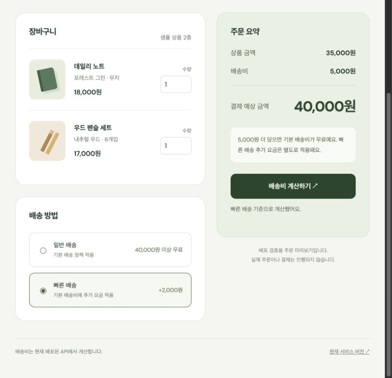

캡처는 브라우저 주소창·탭을 제외한 페이지 본문이다. 로컬 미리보기 포트는 18083이고, 배포 결과는 롤아웃 후 로컬 18084에서 Kubernetes Service로 포트포워딩해 확인했다. 로컬 화면은 클러스터 배포 완료의 증거로 사용하지 않는다.

## 2. 서비스 PR 병합부터 실제 배포까지

[서비스 PR #2](https://github.com/hskhsmm/delivery-pipeline-demo/pull/2)를 병합한 커밋 `6bc08b5`로 Jenkins #8을 수동 실행했다. 빌드는 성공했고 이미지 `sha256:ff2652c842c58fbd34c4f080372c343170807f486dd632e943c9cc481aa9a6d9`를 발행했다.

Jenkins가 [GitOps PR #6](https://github.com/hskhsmm/delivery-pipeline-gitops/pull/6)을 자동 생성했다. 병합 커밋 `87cfe1e`를 Argo CD에서 Refresh로 다시 비교한 뒤 Auto Sync가 적용했다. `Progressing`에서 `Healthy`로 전환됐고 새 Pod가 동일한 이미지 digest로 `1/1`이 됐다.

클러스터에 배포된 `shipping-ui-v2`의 35,000원 주문에서 일반 배송은 배송비 3,000원과 합계 38,000원, 빠른 배송은 배송비 5,000원과 합계 40,000원을 확인했다.

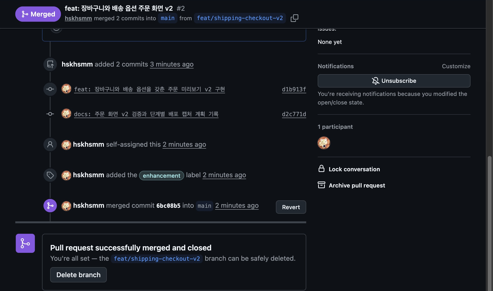

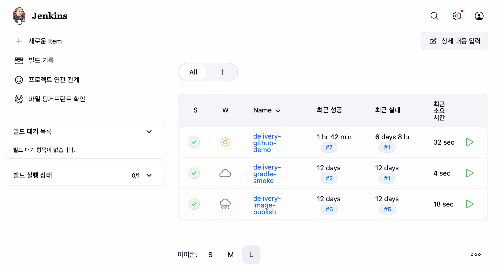

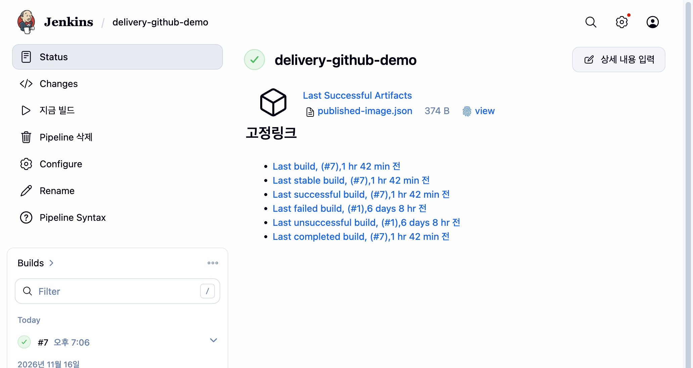

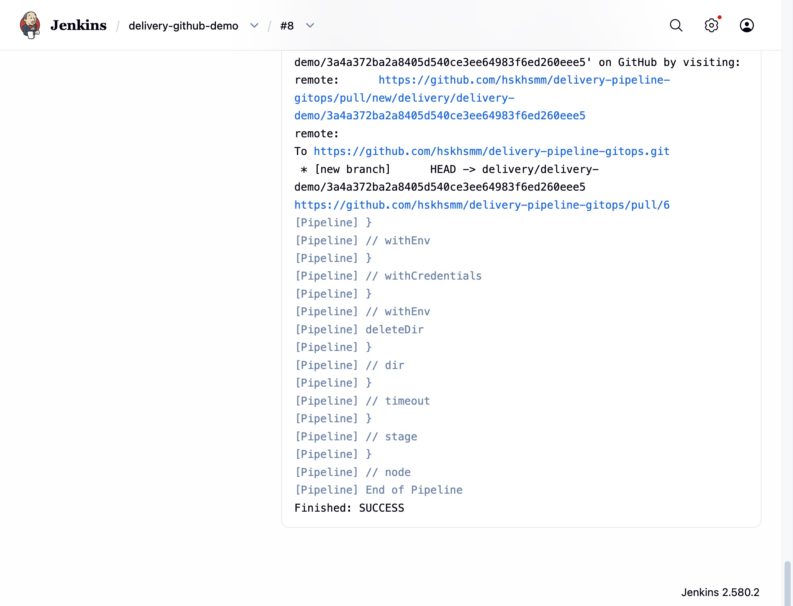

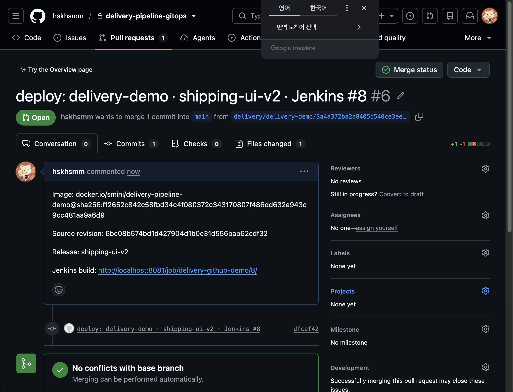

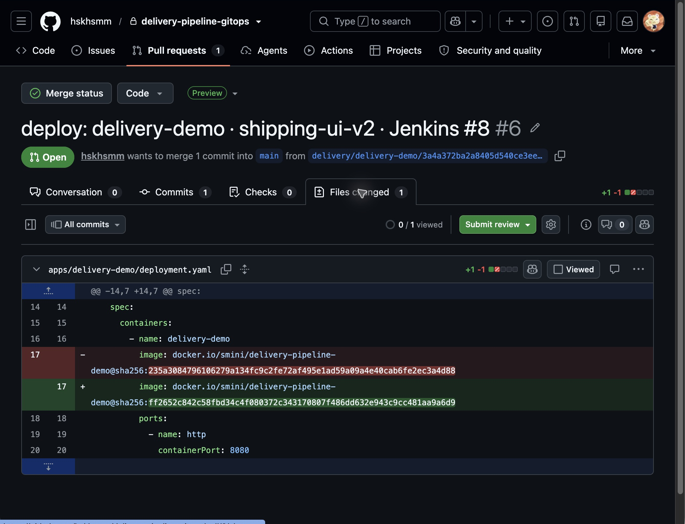

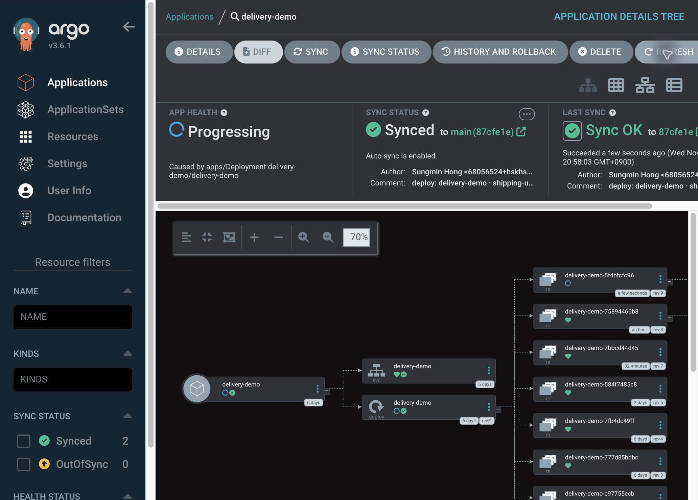

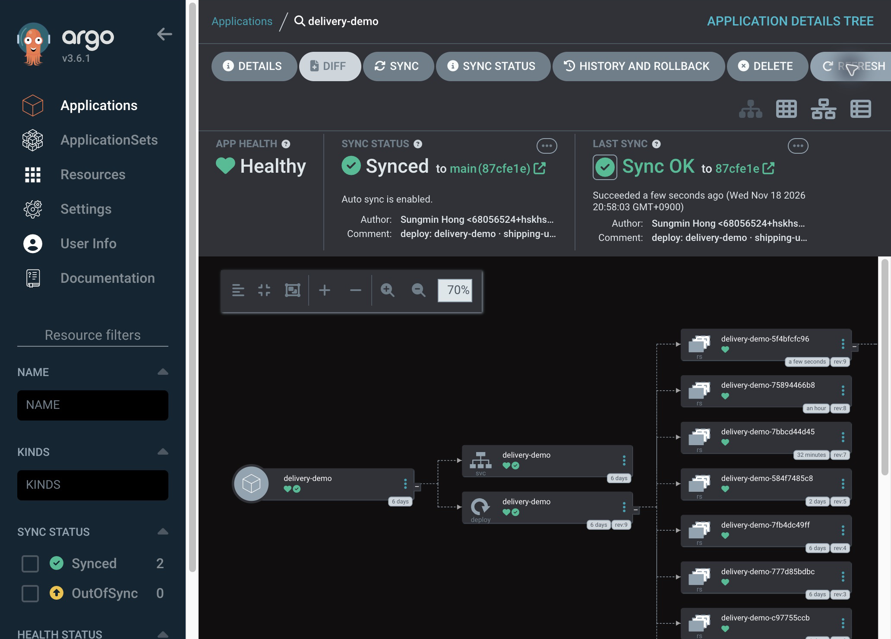

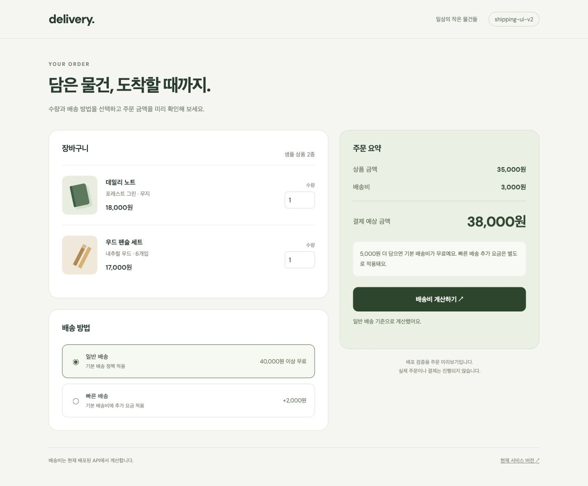

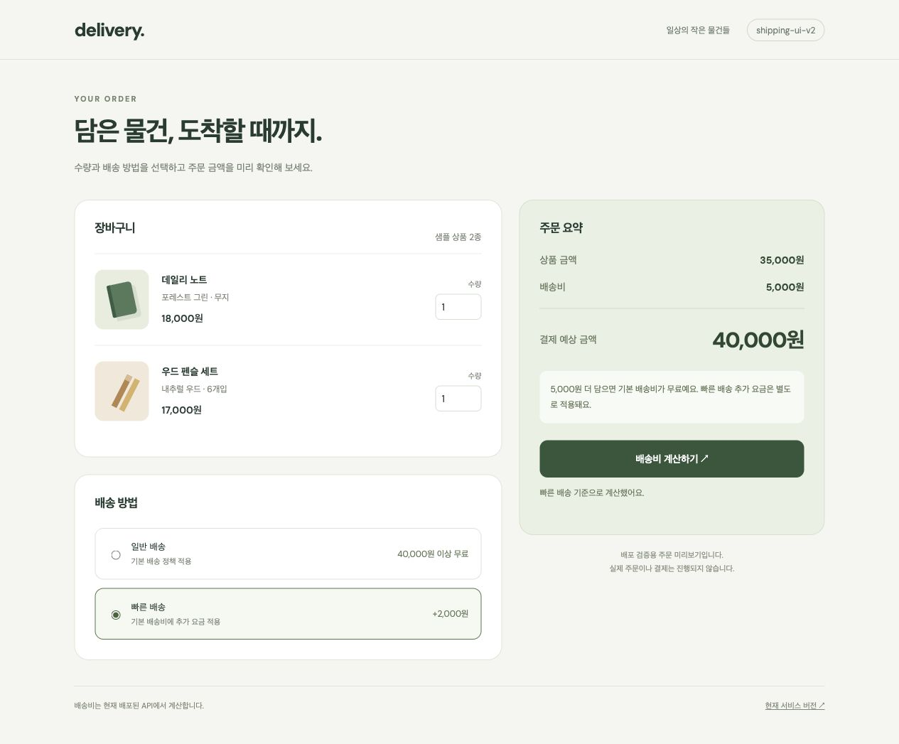
