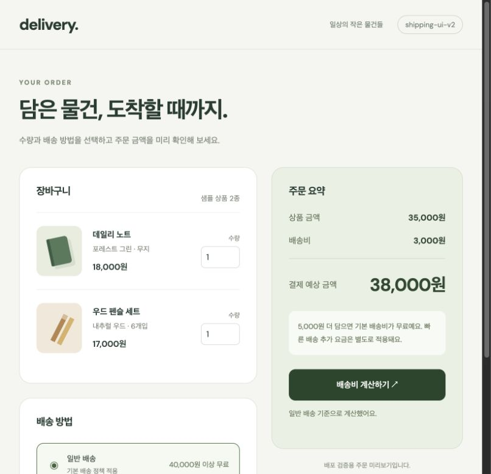
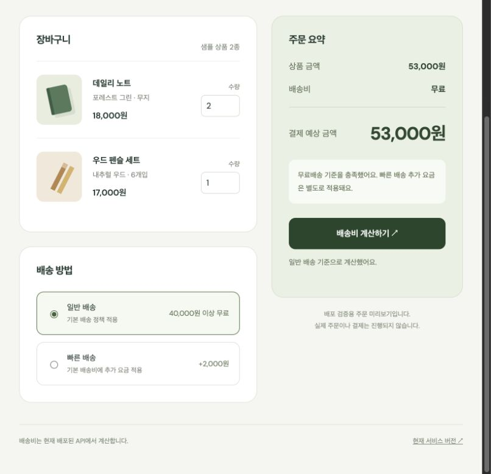

# 주문 화면 v2 업데이트 검증

## 1. 로컬 서비스 변경 확인 — 완료

작업 브랜치 feat/shipping-checkout-v2에서 샘플 장바구니, 수량, 일반/빠른 배송 선택을 구현했다. Java API의 무료배송 기준은 40000원, 빠른 배송 추가 요금은 2000원이다. 기존 subtotal 단독 요청도 일반 배송으로 처리한다.

Gradle build 및 실제 HTTP 테스트가 통과했다. 기존 입력 오류 처리와 함께 39999/40000원 경계값, 빠른 배송, 잘못된 배송 옵션을 확인했다. 브라우저에서 일반 배송, 빠른 배송, 무료배송, 빈 장바구니를 확인했다.

캡처는 브라우저 주소창·탭을 제외한 페이지 본문이다. 로컬 미리보기 포트는 18083이고, Kubernetes 서비스 포트는 18080이다. 로컬 화면은 클러스터 배포 완료의 증거로 사용하지 않는다.

## 이후 검증 순서 — 진행 예정

1. 서비스 PR에서 기능·HTTP 테스트·releaseName을 확인하고 main에 병합한다.
2. 사용자가 Jenkins delivery-github-demo의 Build Now를 누른다. 현재는 병합 자동 빌드 트리거를 구성하지 않았다.
3. 빌드 이름에 shipping-ui-v2가 표시되고 전체 단계가 성공하는지 캡처한다. published-image.json의 소스 커밋과 digest를 기록한다.
4. 자동 생성된 GitOps PR의 제목과 이미지 변경을 확인하고 본문만 캡처한다. 병합은 사용자가 진행한다.
5. Argo CD의 적용 커밋·Synced·Healthy와 Pod의 이미지 digest를 확인하고 본문을 캡처한다.
6. localhost:18080에서 v2와 35000원 일반 배송 합계 38000원, 빠른 배송 합계 40000원을 확인해 캡처한다.
7. 검증이 끝나면 이 문서와 README를 실제 결과로 갱신하는 문서 PR을 올린다.

현재 완료 범위는 로컬 검증이다. Jenkins 이미지 발행과 GitOps 배포 결과는 다음 단계에서 기록한다.
