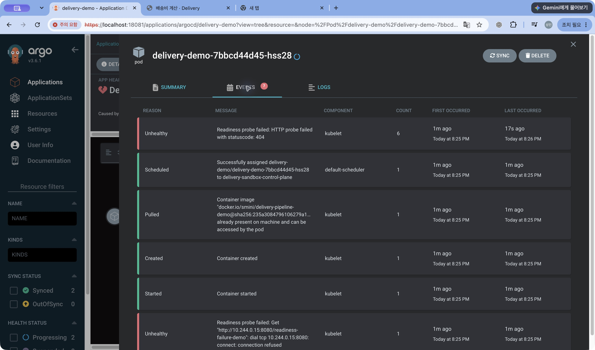

# Readiness 실패 중 기존 서비스 유지 검증

2026년 11월 18일 전용 로컬 kind delivery-sandbox의 delivery-demo에서 검증했다. GitOps PR #4를 squash 병합한 커밋 ca83641을 Argo CD가 자동 적용했다. 기존 이미지 digest 235a308…을 유지하고 readiness 주소를 존재하지 않는 /readiness-failure-demo로 바꿨다. 새 이미지 오류나 서비스 전체 중단을 주입한 실험은 아니다.

## 관찰한 결과

- Argo CD는 Git 설정을 반영해 Synced였지만 앱은 Progressing이었다.
- 새 Pod delivery-demo-7bbcd44d45-hss28은 Running 0/1이었다. Events에서 readiness HTTP 404를 확인했다.
- maxUnavailable: 0, maxSurge: 1로 기존 Pod delivery-demo-75894466b8-9xhlz는 1/1을 유지했다.
- EndpointSlice에서 기존 Pod는 ready=true, 새 Pod는 ready=false였다.
- Service의 port-forward에서 배송비 API 요청 5건이 모두 HTTP 200이고 35000원 무료배송을 응답했다. 화면에서도 계산을 확인했다. 이 표본이 전체 시간의 무중단을 보장하지는 않는다.
- 60초 진행 제한 후 Deployment는 ProgressDeadlineExceeded를 기록했고 Argo CD는 Degraded로 표시됐다. 자동 롤백은 발생하지 않았다.

원본 관찰 자료는 같은 폴더의 pods.txt, deployment.json, endpoints.json, events.json, responses.json에 저장했다. 로컬 샌드박스의 리소스 정보이며 자격 증명은 포함하지 않는다.

## 복구 준비

실험 커밋 ca83641을 git revert한 별도 복구 PR을 만들었다. 이미지 변경 없이 /health와 실험 전 설정으로 복구한다. 전체 revert로 GitOps 저장소의 실험 안내 문서도 제거하며 실제 관찰 기록은 이 문서에 유지한다.

현재 복구 PR 병합과 Healthy 복구 확인은 대기 중이다. 복구 전후 시간을 아직 측정하지 않았으며 롤백 완료로 표현하지 않는다.
