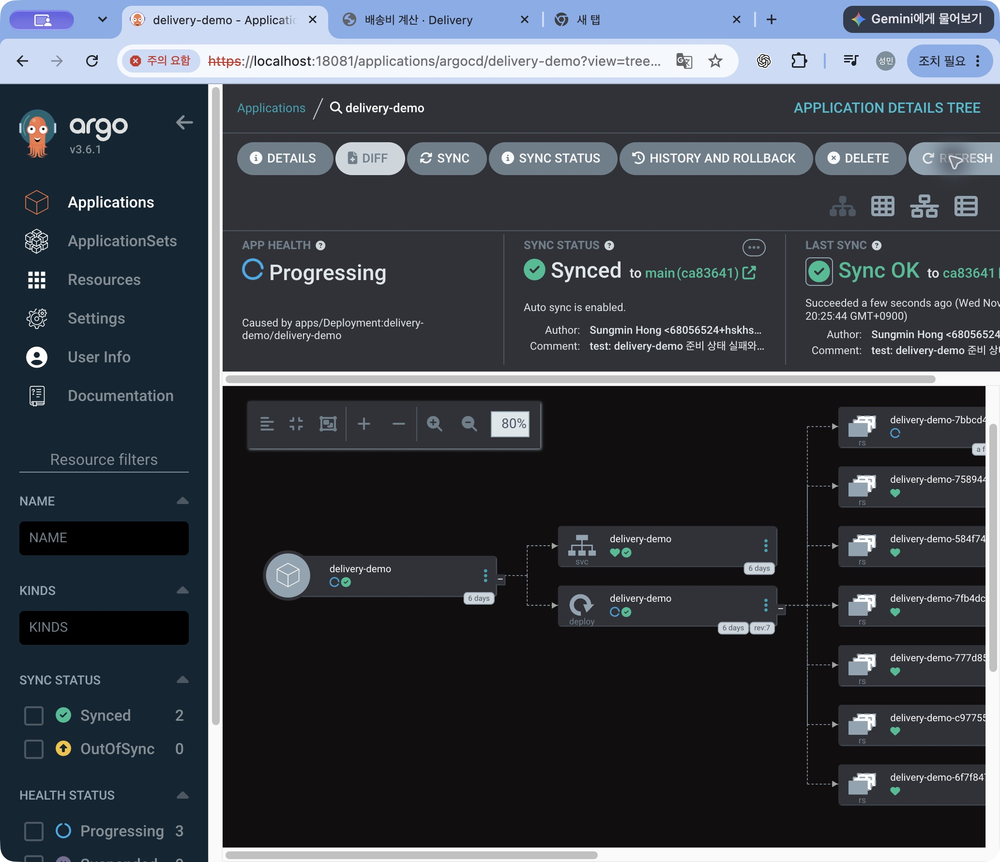
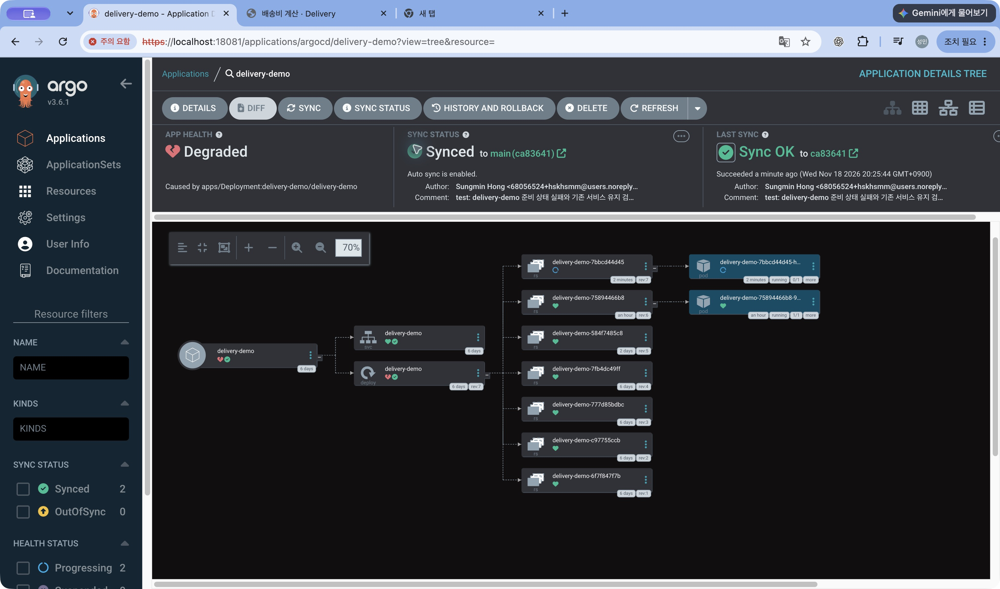
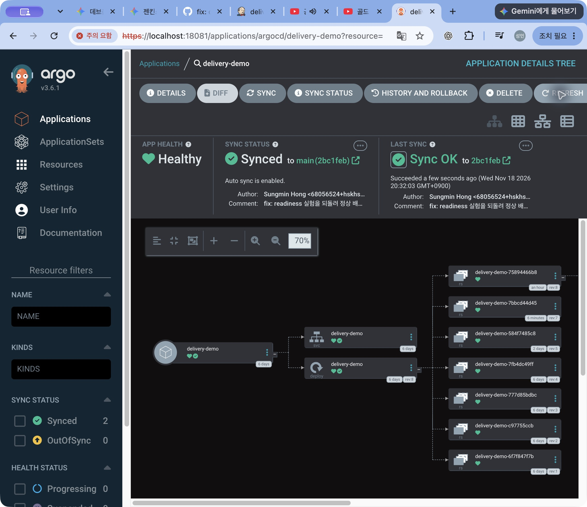
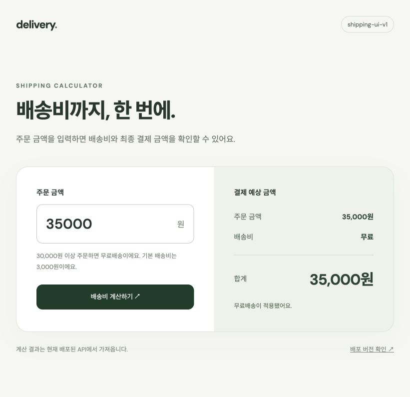

# Readiness 실패 중 기존 서비스 유지 검증

2026년 11월 18일 전용 로컬 kind delivery-sandbox의 delivery-demo에서 검증했다. GitOps PR #4를 squash 병합한 커밋 ca83641을 Argo CD가 자동 적용했다. 기존 이미지 digest 235a308…을 유지하고 readiness 주소를 존재하지 않는 /readiness-failure-demo로 바꿨다. 새 이미지 오류나 서비스 전체 중단을 주입한 실험은 아니다.

## 관찰한 결과

- Argo CD는 Git 설정을 반영해 Synced였지만 앱은 Progressing이었다.
- 새 Pod delivery-demo-7bbcd44d45-hss28은 Running 0/1이었다. Events에서 readiness HTTP 404를 확인했다.
- maxUnavailable: 0, maxSurge: 1로 기존 Pod delivery-demo-75894466b8-9xhlz는 1/1을 유지했다.
- EndpointSlice에서 기존 Pod는 ready=true, 새 Pod는 ready=false였다.
- Service의 port-forward에서 배송비 API 요청 5건이 모두 HTTP 200이고 35000원 무료배송을 응답했다. 화면에서도 계산을 확인했다. 이 표본이 전체 시간의 무중단을 보장하지는 않는다.
- 60초 진행 제한 후 Deployment는 ProgressDeadlineExceeded를 기록했고 Argo CD는 Degraded로 표시됐다. 자동 롤백은 발생하지 않았다.

원본 관찰 자료는 같은 폴더의 pods.txt, deployment.json, endpoints.json, events.json, responses.json에 저장했다. 로컬 샌드박스의 리소스 정보이며 자격 증명은 포함하지 않는다.

## 복구 준비

실험 커밋 ca83641을 git revert한 별도 복구 PR을 만들었다. 이미지 변경 없이 /health와 실험 전 설정으로 복구한다. 전체 revert로 GitOps 저장소의 실험 안내 문서도 제거하며 실제 관찰 기록은 이 문서에 유지한다.

[복구 PR #5](https://github.com/hskhsmm/delivery-pipeline-gitops/pull/5)를 사용자가 병합했다. Argo CD에서 복구 커밋 `2bc1feb10fa0ab144bebf8078fb7ea6f0c3a5b89`로 Synced · Healthy를 확인했다. 비교를 앞당기기 위해 UI의 Refresh를 눌렀으며 Sync 명령으로 직접 배포하지 않았다.

`/health` 경로 복원을 확인했고 실패한 Pod는 제거됐다. 기존 정상 Pod `delivery-demo-75894466b8-9xhlz` 하나가 1/1을 유지했다. 이전 Pod 템플릿으로 돌아오면서 기존 정상 ReplicaSet을 재사용한 결과다. 복구 후에도 API 요청 5건이 모두 HTTP 200이고 35000원 무료배송을 응답했다.

복구 후 원본 상태는 recovered-pods.txt, recovered-deployment.json, recovered-argocd.txt, recovered-responses.json에 저장했다. 복구 소요 시간을 연속 측정하지 않아 MTTR 수치로 표현하지 않는다.

## 포트폴리오에 사용할 설명

> 전용 로컬 Kubernetes에서 readiness HTTP 404를 주입해 새 Pod의 준비 실패와 Argo CD Degraded를 재현했습니다. 기존 Pod의 준비된 엔드포인트와 실제 API 응답을 확인하고, Git revert PR 병합으로 정상 설정과 Healthy 상태 복구를 검증했습니다.

검증 범위는 단일 로컬 클러스터의 준비 상태 설정 오류와 GitOps 복구다. 이미지 버전 변경, DB 마이그레이션 복구, 부하 상황의 가용성과 다중 노드 장애는 이 실험에서 검증하지 않았다.
