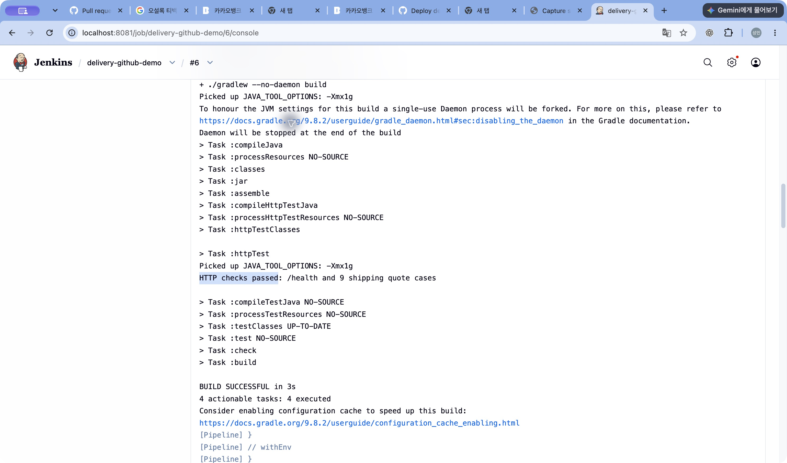
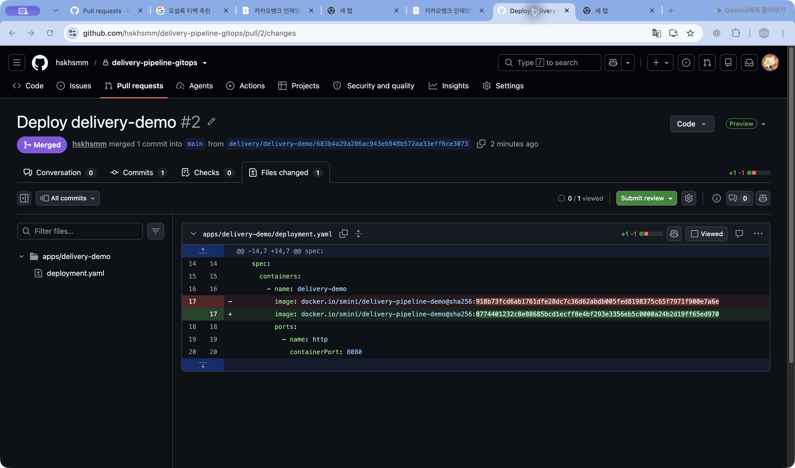
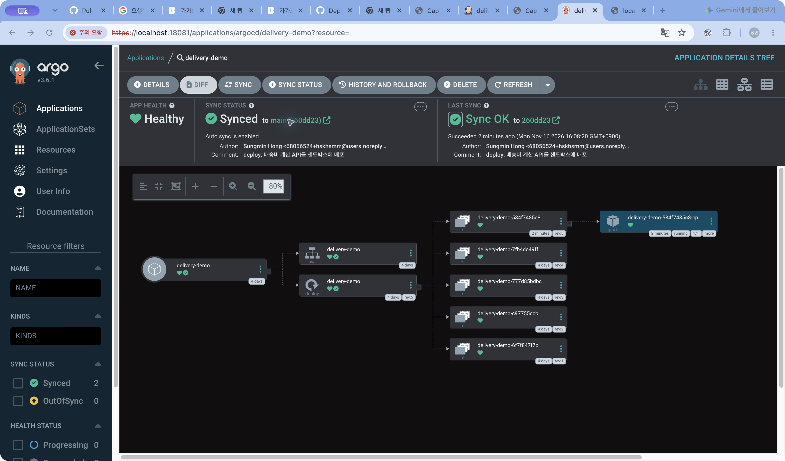
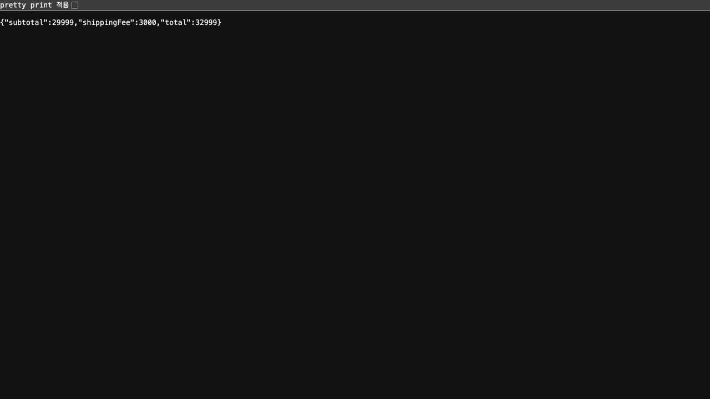

# 배송비 API 배포 검증

2026년 11월 16일, Java 21 배송비 API를 전용 kind 클러스터 `delivery-sandbox`에 배포했다. Jenkins에서 HTTP 테스트, 이미지 발행, GitOps PR 생성을 실행했다. PR은 변경 내용을 확인하고 병합했고, Argo CD가 자동으로 새 이미지를 배포한 뒤 Kubernetes Service를 통해 API를 호출했다.

| 확인 항목 | 결과 |
| --- | --- |
| 서비스 커밋 | [`443d231`](https://github.com/hskhsmm/delivery-pipeline-demo/commit/443d231d7aa80f750c828d5a6459dc1dd7082ebd) |
| 빌드 및 테스트 | Jenkins `delivery-github-demo #6` 성공. 로컬과 Jenkins의 `httpTest`에서 HTTP 요청 10건 통과 |
| 이미지 발행 | Docker Hub `smini/delivery-pipeline-demo`에 발행. Jenkins의 `published-image.json`에 서비스 커밋과 digest 기록 |
| 배포 설정 변경 | [GitOps PR #2](https://github.com/hskhsmm/delivery-pipeline-gitops/pull/2)에서 `apps/delivery-demo/deployment.yaml`의 `image` 한 줄 변경 |
| 배포 결과 | 병합 커밋 `260dd23`으로 자동 동기화. Argo CD `Synced`·`Healthy`, Kubernetes Deployment 롤아웃 성공 |
| 배포 후 검증 | Kubernetes Service로 HTTP 요청 5건을 보내 상태 코드와 응답 본문 확인 |

빌드 결과, GitOps PR, 클러스터의 Deployment에 기록된 이미지 참조가 모두 아래 값과 일치했다.

```text
docker.io/smini/delivery-pipeline-demo@sha256:8774401232c8e88685bcd1ecff8e4bf293e3356eb5c0000a24b2d19ff65ed970
```

**Jenkins가 서비스 코드를 검증했다.** 빌드 #6 콘솔의 `httpTest`에서 `/health` 1건과 배송비 API 9건이 통과했다. `./gradlew build`에 이 작업을 연결해 로컬과 Jenkins에서 같은 검증을 실행했다.



**Jenkins가 이미지 교체를 PR로 제안했다.** PR #2의 diff를 열어 이전 digest가 이번 빌드에서 발행한 digest로 바뀌었는지 확인한 뒤 병합했다.



**Argo CD가 병합 커밋을 반영했다.** `main (260dd23)`에 `Synced` 상태였고, 새 Pod는 `Running`·`1/1`이었다. Kubernetes Deployment의 이미지 참조도 발행 결과와 일치했다.



**배포된 서비스가 배송비를 계산했다.** Kubernetes Service의 포트를 로컬로 연결한 뒤 다음 요청을 보냈다.

| 요청 | HTTP | 응답 |
| --- | --- | --- |
| `GET /health` | `200` | `ok` |
| `GET /shipping-quote?subtotal=29999` | `200` | `{"subtotal":29999,"shippingFee":3000,"total":32999}` |
| `GET /shipping-quote?subtotal=30000` | `200` | `{"subtotal":30000,"shippingFee":0,"total":30000}` |
| `GET /shipping-quote?subtotal=-1` | `400` | `{"error":"invalid_subtotal"}` |
| `POST /shipping-quote?subtotal=30000` | `405` | `{"error":"method_not_allowed"}`, `Allow: GET` |


